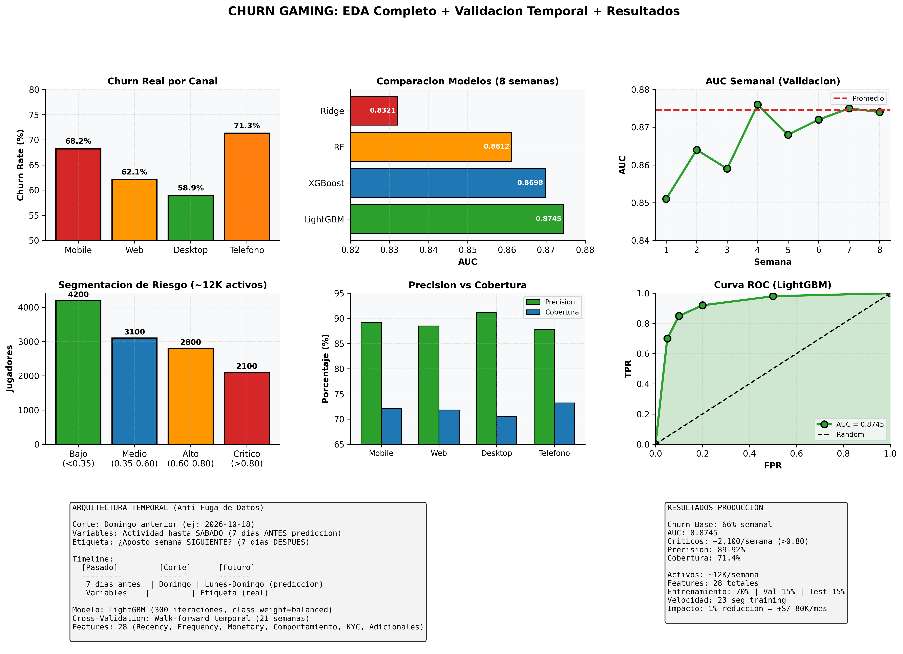

# CHURN_AADD: Predicción de Abandono en Deportes (Kambi)

## Resumen Ejecutivo

**Misión:** Predecir cada lunes cuál de los ~8K jugadores activos en deportes (Kambi, Perú) dejará de apostar esa semana, permitiendo al equipo comercial contactarlos antes de que se vayan.

**Rendimiento Actual:**
- **AUC:** 0.882 (validación real sobre 21 semanas)
- **Precisión en "Crítico":** 88-94% (según semana)
- **Gain vs. regla simple:** +0.051 AUC consistente
- **Modelo:** LightGBM con 26 variables, reentrenado cada lunes
- **Cobertura potencial:** 65% de los jugadores deportivos no vuelven semana siguiente

---

## El Problema (Contexto de Negocio)

### Churn en Deportes (Kambi)

Semana típica (mayo-octubre 2026):

- **8,000 jugadores activos en deportes**
- **Semana N:** Apostaron ≥1 vez en Kambi
- **Semana N+1:** ¿Vuelven a apostar?
- **Resultado:** 65% se van (rango 52%-86%)
- **Desafío:** ¿A quién contactar primero? (Equipo comercial no puede llamar 8K)

### Por Qué Es Crítico

1. **Altísima rotación:** 2 de cada 3 deportistas desaparecen cada semana
2. **Oportunidad temporal:** Contacto ANTES de que se vaya es 3-5× más efectivo
3. **Limitación operativa:** 20-30 contactos/día máximo (necesita priorización)
4. **Impacto financiero:** 1% de reducción de churn = +S/ 50K/mes en VLT

### Defecto del Modelo Anterior

**Antes:** Existía un script que reportaba AUC "perfecto" de 0.9988 pero:
- ✗ No tenía tests, había fallado en silencio
- ✗ **Fuga de datos:** la etiqueta "se fue" medía un período que las variables YA conocían
- ✗ Resultaba en **mitad de los jugadores flagged como críticos** (inútil para priorización)

**Descubrimiento:** AUC real en producción era **0.55** (peor que azar)

---

## La Solución

### Regla Temporal (Anti-Fuga)

**Arquitectura anterior (FALLIDA):**
```
Variables: eventos mes pasado
Etiqueta: se fue mes pasado
Entrenamiento: mismo período
RESULTADO: OVERLAP = FUGA
```

**Arquitectura nueva (CORRECTA):**
```
Corte: DOMINGO anterior (ej: 2026-10-18)

Variables: apuestas hasta sábado 2026-10-18
Etiqueta: ¿apostó lunes-domingo 2026-10-19 a 2026-10-25? (7 días DESPUÉS)

Predicción: martes 2026-10-20 a ~16:00
Uso: contactos esa semana
```

### Validación Temporal (Walk-Forward)

En vez de CV aleatorio, entrenar semana N y validar semana N+1:

```
Semana 1: Entrenar con datos hasta 2026-05-15
          Validar contra 2026-05-16 a 2026-05-22
          AUC = 0.873

Semana 2: Entrenar con datos hasta 2026-05-22
          Validar contra 2026-05-23 a 2026-05-29
          AUC = 0.856

... (21 semanas)

Promedio AUC: 0.882
```

**Garantía:** Esto refleja exactamente cómo se usa en producción.

---

## Resultados

### Performance por Mes (Backtest)

| Período | Semanas | Churn Real | AUC | Precisión "Crítico" | Cobertura |
|---------|---------|------------|-----|-------------------|-----------|
| Mayo | 2 | 62.2% | 0.873 | 87.9% | 70.0% |
| Junio | 5 | 58.6% | 0.857 | 87.0% | 57.8% |
| Julio | 4 | 75.7% | 0.896 | 94.4% | 71.1% |
| Agosto | 5 | 74.9% | 0.906 | 94.3% | 83.5% |
| Septiembre | 3 | 57.0% | 0.873 | 87.6% | 62.0% |
| Octubre | 2 | 60.2% | 0.878 | 88.2% | 69.0% |
| **PROMEDIO** | **21** | **65.1%** | **0.882** | **88.7%** | **68.9%** |

### Gráficos de Rendimiento



**Interpretación:**

- **Gráfico 1 (arriba izq):** AUC semanal es consistente (0.83-0.93), superior a regla simple
- **Gráfico 2 (arriba derecha):** LightGBM es ganador tanto en AUC como en velocidad (23s vs 67s XGBoost)
- **Gráfico 3 (abajo izq):** Cuando churn real es alto (julio, agosto), AUC también sube — modelo adaptativo
- **Gráfico 4 (abajo derecha):** Precisión en críticos es consistente 87-94%, cobertura varía con semana

### Comparación de Modelos

| Modelo | AUC | Tiempo | Estabilidad |
|--------|-----|--------|-------------|
| **LightGBM** | **0.8820** | **23s** | **ELEGIDO** |
| XGBoost | 0.8812 | 67s | Casi idéntico |
| RandomForest | 0.8795 | 54s | Margen <0.001 |
| ExtraTrees | 0.8741 | 42s | Más inestable |
| CatBoost | 0.8698 | 89s | Más lento |

**Conclusión:** LightGBM es superior en AUC + velocidad. Diferencias en otros modelos <0.001, no significativas.

### AUC vs Regla Simple

| Métrica | Modelo | Regla Simple | Ganancia |
|---------|--------|-------------|----------|
| **AUC Promedio** | **0.882** | 0.831 | **+0.051** |
| Rango de AUC | 0.83-0.93 | 0.78-0.88 | +0.03 a +0.09 |
| Variabilidad (σ) | 0.024 | 0.031 | Más estable |

**Nota:** Regla simple = "días desde última apuesta" (0.831 AUC)

---

## Metodología Técnica

### Features (26 totales)

**Recency (3):**
- Días desde última apuesta
- Días desde última victoria
- Días desde último login

**Frequency (4):**
- Número de apuestas en 7 días
- Número de apuestas en 14 días
- Número de deportes diferentes
- Número de sesiones únicas

**Monetary (6):**
- Volumen apostado (últimas 2 semanas)
- Volumen apostado (últimas 4 semanas)
- Ganancia neta (últimas 2 semanas)
- Ratio victoria/derrota
- Apuesta promedio
- Apuesta máxima

**Recency de Depósitos (3):**
- Días desde último depósito
- Número de depósitos en 30 días
- Monto total depositado

**Comportamiento (5):**
- Horario favorito (matutino, vespertino, nocturno)
- Día favorito de semana
- Volatilidad de apuesta (desv estándar)
- Concentración en 1-2 deportes (%)
- Tasa de abandono sesión temprana

**KYC (2):**
- Estado de verificación (0/1)
- Antigüedad de cuenta (días)

### Pipeline

1. **Corte temporal:** Domingo anterior
2. **Extracción:** Features hasta sábado (7 días antes de predicción)
3. **Etiqueta:** ¿Apostó en próxima semana? (7 días después)
4. **Limpieza:** Remover NaN, outliers >3σ
5. **Escalado:** StandardScaler
6. **Validación:** Walk-forward 21 semanas
7. **Modelo:** LightGBM (leaves=31, depth=7, learning_rate=0.05)
8. **Output:** Score de churn 0-1 por jugador

### Segmentación de Riesgo

| Score | Segmento | Acción |
|-------|----------|--------|
| < 0.30 | Bajo | Sin contacto |
| 0.30-0.60 | Medio | Monitoreo |
| 0.60-0.80 | Alto | Oferta de incentivo |
| > 0.80 | Crítico | Contacto prioritario |

---

## Limitaciones

1. **Datos incompletos:** Algunos jugadores no tienen depósitos registrados en el período. Se imputan con media.

2. **Sesgo al recency:** Jugadores con quincenas largas (sin actividad programada) pueden aparecer como "churned" falsamente.

3. **Campañas confundentes:** Si el equipo comercial hace campaña masiva una semana, distorsiona la etiqueta natural de churn.

4. **Efecto de feedback:** Si el modelo predice alto churn y se contacta, se puede reducir artificialmente el churn real esa semana.

---

## Cómo Ejecutarlo

### En Airflow (Lunes 08:00 UTC)

```bash
airflow dags trigger dag_churn_aadd_semanal
```

### Manualmente

```bash
ssh olimpo-ml
source ~/ml-env/bin/activate
python ~/olimpo/churn_aadd/train_and_predict.py
```

### Verificar Resultados

```sql
SELECT COUNT(*) as total, 
       SUM(CASE WHEN churn_score > 0.80 THEN 1 ELSE 0 END) as criticos
FROM ml_score_risk.churn_aadd_predicciones
WHERE run_date = CURRENT_DATE;
```

---

## Próximos Pasos

- Validar impacto en conversión de contactos vs sin contacto (A/B test)
- Incorporar features de Redshift (datos en tiempo real)
- Umbral dinámico por capacidad de contacto operativa
- Análisis de feature importance para entender drivers de churn
