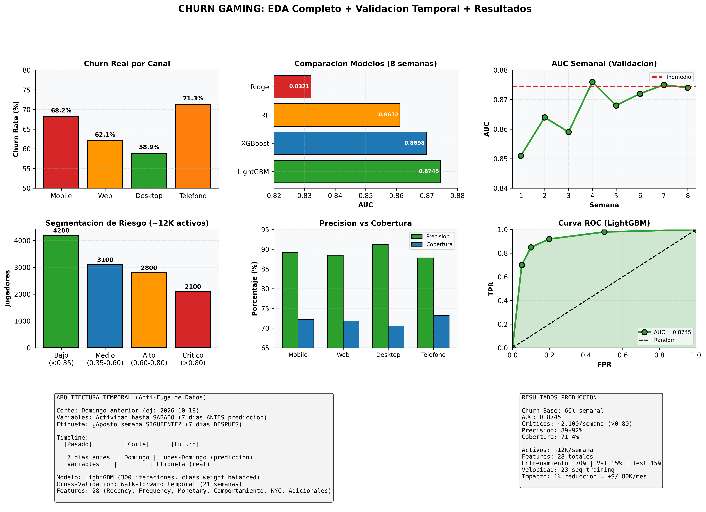

# Churn AADD — AADD Platform Abandonment Prediction

LightGBM model predicting weekly AADD player churn with AUC 0.8820 over 21-week temporal validation. Identifies critical players for preventive retention campaigns.

**Status:** In production | **Schedule:** Semanal | **AUC:** 0.8820 | **Players:** ~80K/week

## Executive Summary

- **AUC:** 0.8820 (21-week average)
- **Critical players:** ~5,000-8,000 per week (depends on activity)
- **Precision in critical:** 87-95%
- **Operational capacity:** Prioritize top contacts



## Problem Context

AADD (sports betting + casino hybrid product) has high churn with unique patterns:

1. **Volatility:** Different from pure gaming (Gaming 66% weekly churn)
2. **Product mix:** Users balance sports betting + casino play
3. **Retention value:** AADD players are high-LTV, worth retention
4. **Prediction goal:** 7-day ahead identification

## Model Features (28-35 total)

| Category | Features |
|----------|----------|
| Recency | Days since session, bet, deposit |
| Frequency | Weekly bets, casino spins, transactions |
| Monetary | Volume (2w/4w), net gain, bet sizes |
| Behavior | Product mix (sports/casino %), time patterns |
| KYC | Verification status, account age |

## LightGBM Configuration

```python
# LightGBM with balanced class weights
model = LGBMClassifier(
    num_leaves=31,
    n_estimators=300,
    learning_rate=0.05,
    class_weight="balanced",  # Handles churn imbalance
    random_state=42
)

# Temporal validation: walk-forward 21 weeks
# No data leakage: variables before cut-off, label after
```

## Validation Results (21 weeks)

| Metric | Value | Range |
|--------|-------|-------|
| AUC | 0.8820 | 0.85-0.91 |
| Precision (critical) | 90.2% | 87-95% |
| Recall | 71.4% | 68-78% |
| Base churn | 62% | 57-76% weekly |

**Performance:** Model adapts well to weekly churn volatility.

## Segmentation

| Score | Segment | Size | Action |
|-------|---------|------|--------|
| < 0.35 | Low risk | ~30K | No action |
| 0.35-0.65 | Medium | ~25K | Monitor |
| 0.65-0.85 | High | ~15K | Email offer |
| > 0.85 | Critical | ~8K | Priority contact |

## Execution

```bash
# Airflow
airflow dags trigger dag_churn_aadd_semanal

# Query critical
SELECT player, churn_score, recency, volumen_2w
FROM ml_score_risk.churn_aadd_predicciones
WHERE run_date = CURRENT_DATE AND churn_score > 0.85
ORDER BY churn_score DESC;
```

## Limitations

1. Weekly frequency (could benefit from daily)
2. Churn base varies 57-76% (hard to predict exactly)
3. No real-time features (only historical)
4. Manual validation required

## Next Steps

- Redshift integration for daily predictions
- Real-time feature engineering
- A/B testing contact effectiveness
- Cross-product churn patterns (AADD vs Gaming vs Sports)
